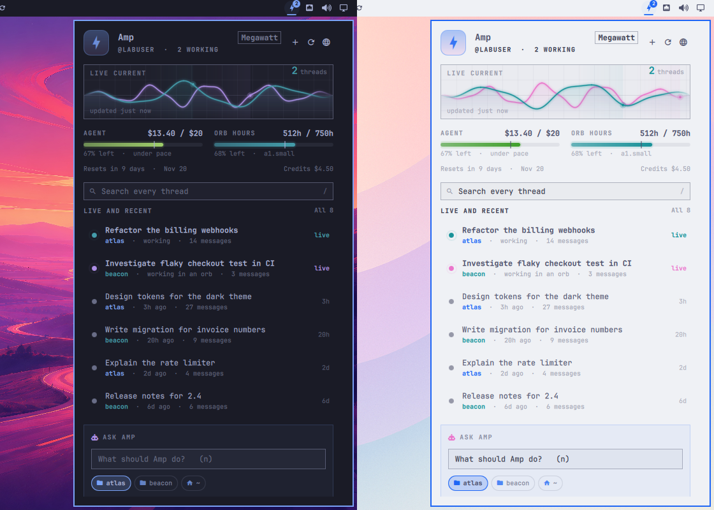

# Ampere

**Amp in your Omarchy bar.** A bolt that glows while [Amp](https://ampcode.com)
works, and a keyboard-first panel with the live current of your threads, your
plan's allowance on pace, every recent thread with its actions, search, and
one box that starts new work in a terminal, in the background or in an orb.



## What it does

- **Live current.** An oscilloscope of the threads Amp is working on. Each
  working thread draws its own colored wave, and its row's pulsing dot has the
  same color, so you can tell which line is which. When nothing is working it's
  a flat line with a slow heartbeat.
- **In your theme's colors.** Ampere reads the active theme's own palette
  (`colors.toml`: red, yellow, green, cyan, blue, magenta) and follows a theme
  switch live. Projects get a stable hue, the agent meter turns green under
  pace and yellow ahead of it, and modes, routes and tools each have their own.
- **A bar icon that knows.** The bolt lights up and pulses while a thread
  works, shows a count when more than one does, and its tooltip says how much
  of your allowance is left.
- **Notified when a turn finishes.** A thread that was working and goes quiet
  sends a desktop notification. Its Open action takes you to the thread.
- **Your allowance, on pace.** Agent usage and orb hours as fuel gauges, with
  a hairline where an even spend through the period would be today, plus the
  reset date and your credits.
- **Every recent thread.** Working threads first, then newest first: project,
  age and length. Thread actions appear under the cursor:
  continue in a terminal (in the directory the thread ran in), open on
  ampcode.com, copy the link, copy the whole thread as Markdown, rename inline,
  archive, and delete with a second press to confirm.
- **Search every thread** with Amp's own query language (`auth after:7d`,
  `repo:…`, `pr:true`).
- **Ask Amp.** Type what you want, pick a directory (from where your threads
  and runners work), a mode (Low, Medium, High, Ultra) and Fast, then:
  - **Enter** opens Amp in a terminal with your message as the first turn,
  - **Ctrl+Enter** runs it headless in the background (`amp -x`), and the
    notification tells you when it's done,
  - **Alt+Enter** sends it to an Amp orb in the cloud for that directory's
    project.
- **Toolbox.** Dashboard, detailed usage, `amp top`, settings, MCP doctor,
  skills, model providers, and Update CLI, each one click away.

## Keys

| Key | Does |
|---|---|
| `j` `k` / arrows | Move through threads |
| `Enter` / `o` | Open the thread on ampcode.com |
| `c` | Continue it in a terminal |
| `y` | Copy its link |
| `m` | Copy it as Markdown |
| `e` | Rename it |
| `a` | Archive it |
| `x` `x` | Delete it (press twice) |
| `/` | Search |
| `n` / `i` | Ask Amp |
| `0`–`4` | Mode: Default, Low, Medium, High, Ultra |
| `f` | Toggle Fast |
| `s` | Show all recent threads |
| `r` | Refresh |
| `t` / `u` / `d` | `amp top`, detailed usage, dashboard |
| `Tab` | Next bar panel |
| `Esc` | Clear the search, then close |

On the bar icon: left-click toggles the panel, middle-click refreshes,
right-click resumes your latest thread.

## Install

Ampere needs the [Amp CLI](https://ampcode.com/manual#getting-started),
signed in (`amp login`). It finds `amp` in `~/.local/bin`, `~/.amp/bin` or
mise; set **Amp CLI path** in the widget's settings if yours is elsewhere.

```bash
omarchy plugin add https://github.com/mtolhuys/ampere.git
```

The bolt lands in the bar's right section; drag it anywhere on the bar.

### Uninstall

```bash
omarchy plugin remove io.github.mtolhuys.ampere
rm -rf ~/.local/state/io.github.mtolhuys.ampere   # the remembered directory, mode and Fast
```

Ampere changes nothing in Amp's own settings, and nothing else to clean up.

### Keybindings (optional)

Ampere answers over IPC, so you can bind it in `~/.config/hypr/bindings.lua`:

```bash
omarchy-shell io.github.mtolhuys.ampere toggle     # the panel
omarchy-shell io.github.mtolhuys.ampere ask        # open, cursor in Ask Amp
omarchy-shell io.github.mtolhuys.ampere search     # open, cursor in search
omarchy-shell io.github.mtolhuys.ampere resume     # continue the latest thread
omarchy-shell io.github.mtolhuys.ampere newThread  # Amp in a terminal
omarchy-shell io.github.mtolhuys.ampere top        # amp top
omarchy-shell io.github.mtolhuys.ampere refresh
omarchy-shell io.github.mtolhuys.ampere working    # prints the working count
```

## Settings

| Setting | Default |
|---|---|
| Notify when a thread finishes a turn | on |
| Show plan usage | on |
| Threads shown | 6 |
| Open threads in | Browser tab (or a web app window) |
| Refresh while Amp works | 8 s |
| Refresh while idle | 60 s |
| Amp CLI path | found automatically |

## How it works, and what it touches

Every program Ampere starts goes through omakit's Run block (an absolute
path, argv only, a closed environment, a hard deadline, bounded output) and
one helper, [`bin/ampere`](bin/ampere). The helper only calls `amp`, and only
these: `top --stream-jsonl` (read for one snapshot, then ended),
`threads list|search|archive|rename|share|delete|markdown|continue`, `usage`,
`runner list`, `-x`, and the toolbox's terminal commands. The panel polls
every 4 s while open, every 8 s while a thread works, and every 60 s otherwise.
With a bar on several screens, one instance polls and shares what it read.

- **Network:** none of its own. Amp's CLI talks to ampcode.com, and links
  open in your browser. URLs are checked to be `https://ampcode.com/…`.
- **Files:** Ampere remembers your last directory, mode and Fast in
  `~/.local/state/io.github.mtolhuys.ampere/memory.json` (0600, through
  omakit's Store block). Copying writes to the clipboard with `wl-copy`.
- **Processes:** terminals open through `uwsm-app` and `xdg-terminal-exec`
  with app id `org.omarchy.agent`, like `omarchy agent`. Background asks run
  as a transient `systemd-run --user` unit so they outlive the shell.
- Ampere respects your Amp permission settings. It adds no
  `--dangerously-allow-all`.

## Compatibility

Proved in the omakit lab on stock **Omarchy 4.0.4** (Hyprland 0.56.2,
Quickshell 0.3.1) with the built-in bar, top and left, dark and light themes.
It uses only shell APIs present there and in current `omarchy-dev`. On
third-party bars such as Omacale, the widget renders like any other plugin
widget.

## Development

See [DEVELOPMENT.md](DEVELOPMENT.md).

## License

MIT
